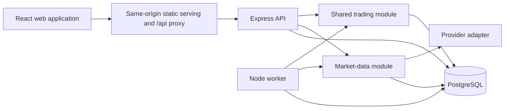
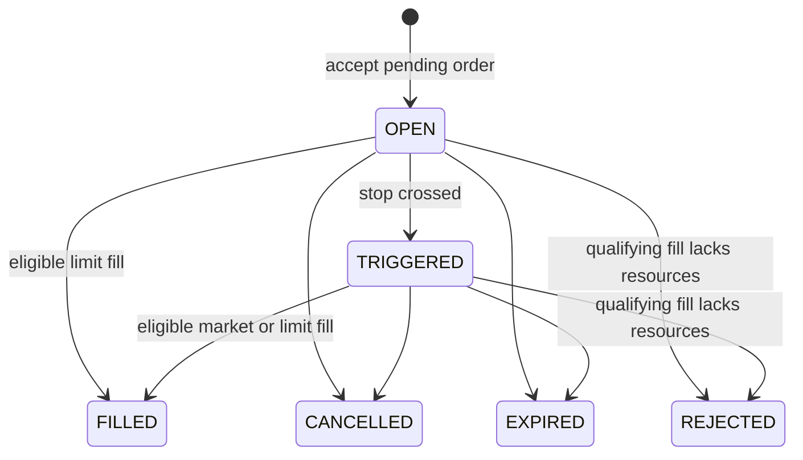

# Greenfield PERN paper-trading design

Date: 2 November 2026. Status: authorized for completion by the user on 2 November 2026 (“okay then let’s do it”), following foundation integration. Provider enablement remains conditional on validation.

## Intent and scope

Build a maintainable paper-trading application with correct accounting, reliable order execution and the current UI's capabilities. Start with a fresh PostgreSQL database; Oracle data transfer and compatibility with existing HTTP routes are unnecessary. Existing databases and volumes must remain untouched during development.

The user selected continued development of the recommended greenfield architecture after discussing migration and starting fresh. The agreed direction is React, a modular Express/Node application, a separate worker using the same backend modules, and PostgreSQL. The detailed product rules below are the author's proposed defaults, not additional requirements stated by the user.

Retain registration/login, stock search and details, charts, market orders, limit/stop/stop-limit orders, portfolio and execution history, watchlist folders, notes, alerts/notifications, region/display-currency selection, and valuation history. Keep the current visual design and reuse suitable React code; adapt its data access and currency calculations to the new contracts.

Initial sizing assumption: a small multi-user deployment, with one API process and one worker. Correctness must survive additional processes and restarts. No throughput target or public-production availability commitment has been supplied; performance targets should be measured during implementation.

## Goals, constraints and deliberate limits

- One INR account per user, with an opening credit of **INR 1,000,000 (₹10,00,000)**. Currency is fixed after account creation. This resolves the three conflicting starting balances in the current project.
- Support the existing US, Indian, UK, European, Japanese and Hong Kong stock regions where provider metadata and freshness requirements are satisfied. Indices are view-only. Region is a discovery/display preference, not an accounting rule.
- Full fills only; quantities up to four decimal places are allowed by this simulator. Long positions only. Fees and slippage are zero initially and must be stated in the trading UI.
- Execution uses eligible regular-session observations only. Provider session UNKNOWN or CLOSED blocks execution. Market orders outside the eligible session are rejected immediately rather than queued.
- Pending orders reserve neither cash nor shares. Funds/ownership are checked at execution; a qualifying order with insufficient resources becomes REJECTED. The order form must explain this policy.
- No external deposits, withdrawals, account reset feature, shorting, leverage, partial fills or multiple cash wallets in the initial release. Corporate actions are addressed under market-data semantics below.
- Preserve financial history across process restarts. Startup must never reset a user or run a destructive demo seed.
- No application financial arithmetic through binary JavaScript floating point. No execution at a browser-supplied price. No valuation that silently substitutes zero for a missing quote.

## Approaches considered

| Approach | Benefits | Trade-offs | Disposition |
| --- | --- | --- | --- |
| Modular Express application with API and worker entrypoints, PostgreSQL-owned durability | Shared trading implementation, modest operational footprint, explicit transaction ownership | Account changes serialize; worker coordination must be deliberate | Selected architectural direction in the conversation |
| Express application with PostgreSQL functions/triggers owning trading workflows | Database-centric enforcement can suit a database-focused project | More procedural SQL and divided application/database workflow ownership | Considered during the audit; not the proposed implementation |
| Separate independently deployed modules with a message broker | Independent scaling and process ownership | More operational state and distributed failure handling than current requirements justify | Future option if measured workload requires it |

The selected design uses a single database transaction for each business mutation. API and worker are separately runnable processes from one codebase, with shared modules and migrations.

## Runtime and repository shape



Suggested repository structure:

```text
apps/
  web/                         React/Vite application
  server/
    src/api.ts                 Express entrypoint
    src/worker.ts              background entrypoint
    src/modules/
      identity/                users and sessions
      accounts/                account creation, cash records and reconciliation
      trading/                 orders, executions and positions
      market-data/             instruments, quotes, FX, history and provider adapter
      portfolio/               valuation and snapshots
      watchlists/
      notes/
      alerts/                  alerts and notifications
    src/platform/              configuration, database pool, logging, HTTP errors
    migrations/
packages/
  contracts/                   validated request/response shapes shared with web
```

Use TypeScript for new backend and contract code. Existing React JavaScript can remain while its network layer adapts. Use Express, `pg`, versioned SQL migrations, and a supported Node LTS runtime. Package versions, the validation library and the exact migration runner are builder choices to verify and pin during implementation.

Module interfaces should hide their rules. HTTP handlers authenticate, validate, invoke a module and serialize its result. They do not update balances or assemble multi-module transactions. The worker calls the same trading interface as the API. Modules may expose narrow internal transaction helpers, but callers cannot independently commit pieces of an execution.

The market-data seam has a real need: the old Python provider must be replaced, and deterministic fixtures are required for testing. Start with a Node provider adapter plus a fixture adapter. A provider must demonstrate quote, currency/unit, observation/session, FX, index and history coverage before live trading is enabled for a market. Provider selection is an implementation validation task, not an assumption of equivalent yfinance behavior.

## Domain model and persistence

Canonical terms are in [GLOSSARY.md](../../../GLOSSARY.md).

| Table | Principal data and invariants |
| --- | --- |
| `users` | UUID, normalized unique username/email, password hash, active flag, created time |
| `sessions` | User, hash of a cryptographically random session token, expiry and revocation |
| `accounts` | UUID, unique user, base currency INR, cash balance ≥ 0, monotonic cash sequence and valuation-dirty marker |
| `cash_movements` | Append-only signed amount, resulting balance, account sequence, reason OPENING_CREDIT/BUY/SELL, optional execution reference |
| `instruments` | UUID, provider/symbol unique pair, name, exchange, supported quote currency, raw-to-major-unit multiplier, tradable flag |
| `latest_quotes` | One current usable observation per instrument: major-unit price, raw unit metadata, observed/fetched times, session and provider; older observations cannot replace newer ones |
| `latest_fx_rates` | Currency pair, exact rate, provider observation time and fetch time; direction is explicit |
| `orders` | Account, instrument, side, type, quantity, stop/limit conditions, state, trigger/expiry/completion times, rejection reason, idempotency key and request fingerprint |
| `executions` | Immutable order reference UNIQUE, account, instrument, quantity, major-unit price, native amount, FX rate, base settlement, allocated costs, quote/FX timestamps, realized P/L and execution time |
| `positions` | UNIQUE account/instrument, quantity > 0, remaining quote-currency cost basis and base-currency cost basis; delete on full liquidation |
| `watchlist_folders` | Owner, name unique within owner; every user has a persistent default folder |
| `watchlist_entries` | Owner, folder, instrument, UNIQUE folder/instrument; folder ownership enforced by a composite owner/folder foreign key |
| `notes` | Owner, title, body, optional instrument and timestamps; all access owner-scoped |
| `price_alerts` | Owner, instrument, ABOVE/BELOW, positive threshold in quote currency, active/triggered state and trigger observation time |
| `notifications` | Owner, message, read time, alert reference UNIQUE for one notification per alert |
| `portfolio_snapshots` | Account, observation time, base currency, cash/holding/total values, quality and relevant quote/FX time range; deduplicated by account/sample bucket |

A user, account, opening cash movement and default watchlist folder are created atomically. An opening credit is ledger data, not an unexplained account balance. Cash movement account sequences are unique and monotonically allocated under the account lock. Executions and cash movements are append-only for runtime database roles; administrative schema ownership is held separately.

The account balance and positions are transactionally maintained projections. Reconciliation must verify the balance against opening credit plus signed cash movements, and positions/cost bases against executions in recorded account order. Each execution stores the allocated costs needed to audit realized P/L. Accounts cannot be deleted through a public route in the initial release.

Use UUID strings for public identifiers and UTC `timestamptz` values for events. Define NOT NULL, positive/finite value, side/type/state consistency, uniqueness and foreign-key constraints in SQL as well as validating requests. PostgreSQL `numeric` provides exact decimal storage; precision and scale still require explicit choices. [PostgreSQL numeric documentation](https://www.postgresql.org/docs/current/datatype-numeric.html).

Decimal policy: quantities `numeric(20,4)`; normalized prices `numeric(20,8)`; FX rates `numeric(24,12)`; cash and settlements `numeric(20,2)`; remaining/allocated cost bases `numeric(28,8)`. Reject over-scale inputs instead of silently rounding user conditions. Apply half-up rounding to INR settlement once per execution. Maintain cost-basis allocation at eight decimal places and consume the exact remaining basis on a full sell. Reject a trade whose rounded settlement is zero or outside supported ranges.

Keep arithmetic in PostgreSQL `numeric` expressions or a verified decimal implementation; the builder can choose between those within this policy. Public decimal values are JSON strings. Frontend contracts convert values to bounded numbers only for charts and display; order validation and accounting remain server-authoritative. Large sequence values are also strings in JSON.

## Trading rules and lifecycle

Order types: MARKET, LIMIT, STOP and STOP_LIMIT. Side is BUY or SELL. Accepted pending orders begin OPEN; successful immediate market orders are returned FILLED. States and transitions:



MARKET follows the immediate submission path and is not left OPEN for a worker. A valid immediate attempt that fails a business check is persisted REJECTED with its idempotency result; malformed/unauthenticated requests fail before order creation.

| Order | BUY condition | SELL condition | Execution price |
| --- | --- | --- | --- |
| MARKET | Fresh regular-session quote available | Same | Observed major-unit quote |
| LIMIT | Quote ≤ limit | Quote ≥ limit | Observed quote, including price improvement |
| STOP | Quote ≥ stop activates order | Quote ≤ stop activates order | First eligible observed quote at/after activation |
| STOP_LIMIT | Quote ≥ stop activates order; then quote ≤ limit permits fill | Quote ≤ stop activates order; then quote ≥ limit permits fill | Eligible observed quote |

Stop activation persists even if no fill follows. For example, BUY stop 80 / limit 85 with a quote of 90 becomes TRIGGERED and remains unfilled; a later eligible quote of 84 fills it. A price gap is handled using observed quotes; the simulator does not invent an intervening fill.

The worker can trigger and fill in the same transaction when the same observation meets both conditions. `expires_at <= database_now` takes precedence over triggering or filling. Expiry is evaluated even without market data. Omitted expiry means good-until-cancelled. Expiry input must be a future timezone-qualified timestamp. Invalid required prices, non-finite quantities, unsupported instrument metadata and view-only indices are rejected at submission.

There are no reservations: two pending buys can both be accepted against the same available cash. If the first fill consumes the money, the next otherwise qualifying order becomes REJECTED with `INSUFFICIENT_FUNDS`. Competing sells behave analogously. Provider failures leave pending orders live; a stale or absent quote is not a business rejection. Terminal orders do not transition again.

For LIMIT orders OPEN and triggered stop-limit orders, cancellation is permitted until a fill commits. BUY order stop and limit need not have a fixed relative relationship; both conditions are evaluated exactly as specified. Changes to a live order require cancelling it and submitting a new order.

## Atomicity, idempotency and concurrency

The trading module owns submission, cancellation and evaluation interfaces. Market data is fetched outside financial transactions. On a persisted order transition or execution:

1. Begin on one checked-out PostgreSQL client.
2. Lock the account row first; then lock an existing order and its position as needed. Every mutation uses this lock order. Creation of a previously absent position is serialized by the account lock.
3. Recheck ownership/user status, idempotency, current order state, expiry, quote/session freshness, FX freshness, funds and quantity. Use the database clock for expiry/freshness comparisons, with a documented small future-clock-skew tolerance.
4. Apply any stop activation. On a fill, insert one execution, append one cash movement, update account cash and cost bases/quantity, and mark the order FILLED with its execution reference. On rejection or expiry, persist that terminal state without financial mutation.
5. Mark the account valuation dirty after a fill; commit. Any database error rolls back the entire transition and all financial writes.

All statements share the same `pg` client. [node-postgres transaction documentation](https://node-postgres.com/features/transactions). Account row locking serializes mutations for that account; unrelated accounts can proceed concurrently. [PostgreSQL locking documentation](https://www.postgresql.org/docs/current/explicit-locking.html).

Every `POST /api/orders` requires an `Idempotency-Key`. Store it uniquely per account with a fingerprint of normalized order intent. Repeating the same intent returns the persisted order/result; reusing the key with different intent returns 409. Check for a prior result before requiring new provider data, and recheck inside the account transaction. A duplicate successful request must still replay during a provider outage. Keep keys with order history for the life of the account.

The worker first selects candidate IDs without holding financial locks, then obtains account locks with `FOR UPDATE SKIP LOCKED`, rechecks the order and processes it. Avoid locking orders before accounts in a batch. Competing worker attempts either skip a busy account or observe the completed transition. A unique execution/order constraint is a second safeguard. Lock serialization makes cancellation versus fill resolve to whichever transition commits first. Retry bounded deadlock/serialization failures with jitter; do not retry permanent validation failures.

Quote refresh uses a PostgreSQL session advisory lock per provider/batch ownership, held on a dedicated connection across a bounded provider call, to prevent duplicate refresh work. The provider request has a timeout; the lock is explicitly released in a finally block, and connection loss also releases it. This is separate from account transaction locks. The builder chooses the batch/lock granularity and rate limits after provider validation.

## Quotes, FX and valuation

Normalize quote currency and units from provider metadata. For example, a pence-denominated quote is converted to GBP major units using its multiplier before trading. Never infer currency solely from a symbol suffix. Store raw metadata and normalized values for traceability. Price limits and stops are expressed in that normalized quote currency, and the form must show its currency explicitly.

Default execution freshness: quote observation at most 60 seconds old and confirmed regular session; FX observation at most 24 hours old. Permit at most five seconds of future timestamp skew. INR/INR conversion uses exact rate 1. Fetch timestamps do not extend observation validity. Treat these values as configuration with fixtures and tests. If the provider cannot meet them for a market, trading for that market remains unavailable with an explicit reason; do not substitute a previous close or a hardcoded FX rate for execution.

Refresh active instruments about every 15 seconds, subject to provider rate limits. Active means held, in a live order, watched, or referenced by an active alert. Use a slower refresh for discovery metadata; avoid polling the full catalogue at the same rate. Quote/detail requests can request a bounded on-demand refresh through the market-data module without holding an account transaction open. Return unavailable/stale state when a usable observation cannot be obtained.

Use unadjusted prices for executions and matching chart semantics. Automatic split/dividend accounting is outside the initial release: if the adapter detects a corporate-action change affecting a held or ordered instrument, pause its execution and flag its valuation for review; never silently apply adjusted history to an unadjusted position. A provider that cannot supply the required action/session/unit metadata cannot be enabled for live simulation. Exact provider selection and detection mechanics must be validated before the market-data milestone is accepted.

Persist the execution's actual quote amount, base conversion rate, rounded INR settlement and source observation times. A BUY adds native cost and INR settlement to the position's respective bases. A partial SELL allocates each remaining basis proportionally; average acquisition cost is unchanged by the sell. Realized P/L is INR proceeds minus allocated INR cost. Base-currency unrealized P/L includes FX effects and must be labeled accordingly.

Value each position using its latest observation and current eligible FX for valuation, then aggregate in INR. Valuation may use last-known prices from a closed market, labeled with their observation time and quality. It may show stale known values with a warning. Missing price or required FX produces a null position value and an incomplete portfolio total, with known cash still visible. A missing price never becomes zero.

Sample complete portfolio snapshots approximately every five minutes and soon after detecting a dirty account. Samples describe actual observation time; multiple closely spaced trades may share the next sample. Do not promise a separate snapshot for every execution or label a later sample as an earlier trade time. Include the range of underlying observation times and flag stale inputs. Skip incomplete numerical snapshots and surface the reason in worker health. Read cash/positions consistently for valuation, and use account-version checking or a repeatable-read snapshot to avoid combining pre-trade holdings with post-trade cash.

Display-currency conversion is presentation only. Persist no changes when region or display currency changes. Supply conversion source/time/quality so the UI can label estimates; unsupported conversions show unavailable values.

## Identity, ownership and HTTP contracts

Serve web and `/api` on one origin in production. Use opaque server sessions: random token in a Secure production, HttpOnly, SameSite=Lax cookie; store only its hash, with a default 24-hour expiry. Logout revokes the session. Validate user active state on authenticated requests and before worker execution. A deactivated account's live orders become REJECTED with an account-disabled reason when evaluated; no new execution is permitted.

Use maintained bcrypt password hashing, rate-limit registration/login and expensive provider endpoints, and validate Origin for unsafe browser requests including login. Require a session-bound CSRF token for authenticated mutations. Enforce body limits and runtime schemas. Production startup requires secrets and explicit database credentials; there are no usable default production credentials.

Every account, order, folder, note, alert and notification lookup is owner-scoped. Database ownership constraints complement request checks. Folders are explicit rather than nullable. Deleting a named folder moves its instruments to the default folder, deduplicating collisions, then removes it atomically. The default folder cannot be deleted or reassigned. Instruments may appear in several folders, once per folder.

Proposed resource routes:

| Resource | Routes |
| --- | --- |
| Identity | `POST /api/auth/register`, `POST /api/auth/login`, `POST /api/auth/logout`, `GET /api/auth/me`, `GET /api/auth/csrf` |
| Trading | `POST /api/orders`, `GET /api/orders`, `GET /api/orders/:id`, `POST /api/orders/:id/cancel`, `GET /api/executions` |
| Account/portfolio | `GET /api/account`, `GET /api/portfolio`, `GET /api/portfolio/snapshots` |
| Market data | `GET /api/instruments`, `GET /api/instruments/:id`, quote/history routes under that instrument, `GET /api/fx-rates` |
| User tools | Folder and entry resources under `/api/watchlists`; CRUD `/api/notes` and `/api/alerts`; list notifications and mark selected owned IDs read |
| Operations | `/api/health/live`, `/api/health/ready`; internal worker status |

All trading requests identify an instrument by its canonical ID. MARKET rejects submitted execution-price fields. Order requests carry side, type, decimal-string quantity, conditional decimal-string stop/limit prices and optional expiry. Pagination is bounded, cursor-based and deterministically ordered. Error responses use `{error: {code, message, fields?, requestId}}`; 400 validation, 401 no session, 403 forbidden, 404 unknown/other-owner resource, 409 state or idempotency conflict, 429 throttling, 503 transient dependency unavailability. Business-rejected accepted orders are returned as persisted order resources with a reason; successful creation uses 201 and idempotent replay uses 200. Provider-unavailable immediate orders are not accepted or assigned a new durable idempotency result, so callers may retry.

Frontend contracts adapt decimal strings and error codes once in the network/view-model layer. Replace the current localStorage bearer-token handling with cookie sessions and CSRF attachment. Keep chart number conversion separate from order-payload creation. The UI shows order state/reason, account/base currency, quote observation time and data quality.

## Worker, operations and failure behavior

One worker entrypoint runs bounded non-overlapping tasks: market-data refresh, live-order evaluation, expiry processing, alert evaluation and portfolio sampling. Timer intervals are scheduling goals, not guarantees. Limit batch sizes and concurrency; use backoff on provider failure. Active orders must be considered even when their instrument is neither held nor watched.

One-shot alert firing claims the still-active alert and inserts its uniquely associated notification in the same transaction. Check only fresh observations; closed-market last-known data must not repeatedly generate a new historical crossing. Notifications remain durable and deduplicated on retries. Polling from the web is sufficient initially.

Database migrations are an explicit deployment step guarded against concurrent runs. API and worker verify the expected schema version before readiness. Seeding is opt-in for development, repeatable without deleting existing trading history. Stop on migration failure. No runtime process starts schema-changing background work.

Development Compose contains PostgreSQL, API, worker and web. Production builds static web assets and runs compiled API/worker processes with graceful shutdown and bounded connection pools. Shutdown stops new work, completes or rolls back in-flight transactions and releases connections. Provider calls and database operations have timeouts.

Expose separate liveness and readiness: database connectivity and schema version for API readiness; worker heartbeat and per-task last-success times for worker status. Return market-data availability/age to clients independently of process liveness. Structured logs carry request/order/execution IDs and safe error codes, and exclude tokens, passwords and raw sensitive headers. Track refresh latency/errors, stale coverage, rejected/filled orders, worker lag and reconciliation discrepancies. Configure persistent PostgreSQL storage and backups for a deployed installation.

## Verification and acceptance

Use deterministic clocks and quote/FX fixtures for rule tests. Use real disposable PostgreSQL integration tests for constraints, commits, rollbacks and competing transactions. Keep the fixture adapter explicit in development/tests; production cannot silently fall back to synthetic prices.

Required scenarios:

- Concurrent duplicate submissions, including successful replay during provider outage; same key/different intent conflicts.
- Concurrent buys with insufficient combined funds, simultaneous first-position buys, competing full sells and cancel-versus-fill races.
- A fault between execution insertion and completion rolls back execution, cash movement, position and order state together; restart permits one eventual fill.
- Weighted-average buys, partial/full sells and buy-after-liquidation reconcile both cost bases; opening balance and every cash movement reconcile exactly.
- Native USD and INR trades, a minor-unit quote, FX gains/losses, rounding boundaries and unsupported/missing metadata.
- Stop activation remains persisted across restart; a gapped stop-limit waits for a valid limit quote; expired orders do not fill even when pricing is unavailable.
- Pending orders without reservations are rejected only when an eligible fill fails resource checks. Closed/unknown sessions, stale observations and absent FX cannot execute.
- Missing prices produce incomplete/null valuations; closed-market known prices are labeled; snapshots cannot mix account versions or invent history.
- Cross-user attempts against all owned resources fail; folder deletion deduplicates default entries; one alert yields one notification under competing workers.
- Login, logout/revocation, inactive users, CSRF, malformed decimals, invalid expiry and bounded pagination behave as contracted.
- Clean setup, restart without seeding/reset, worker recovery, stale-data responses, production build and smoke flows through all retained pages.

## Delivery outline and builder discretion

This is a project-sized change. After design approval, write a separate implementation plan, then deliver vertical slices: schema/contracts and identity/accounts; provider validation; immediate execution and valuation; pending orders/worker; remaining user tools; retained UI integration and deployment verification. Acceptance of a slice requires its meaningful transaction/behavior checks before broadening scope.

Use a separate greenfield checkout/worktree during implementation. Do not reshape the existing working application or remove its Oracle/Python files until the replacement's functional coverage is demonstrated. No Oracle export/import pipeline or dual writes are required.

Builder choices include exact package versions, validation/test/migration libraries, minor route naming within the stated resource model, connection-pool sizing, retry budgets, provider batch sizes and UI component organization. Benchmark before adding infrastructure. Changes to accounting currency, opening funds, reservation policy, fill/session behavior or initial feature scope require revisiting this design.

The assumptions most worth user review are INR 1,000,000 starting cash, regular-session/fresh-quote execution, no pending-order reservations, and the simplified full-fill/corporate-action limitations. These choices make the simulation's behavior explicit rather than inheriting accidental rules from the old code.
